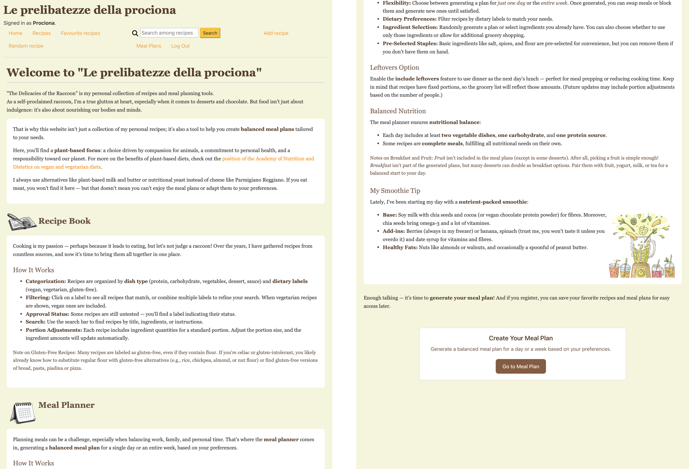
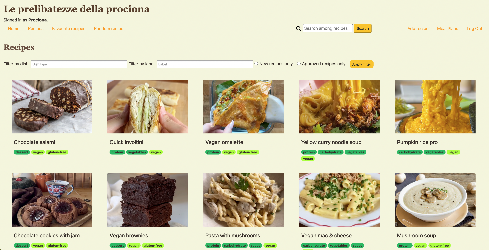
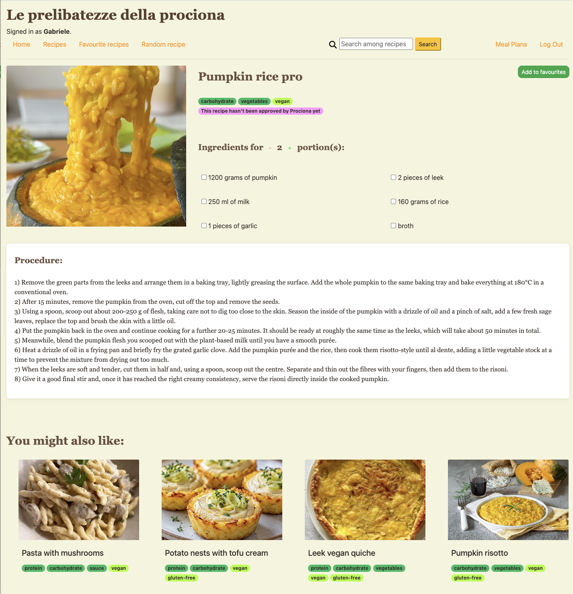
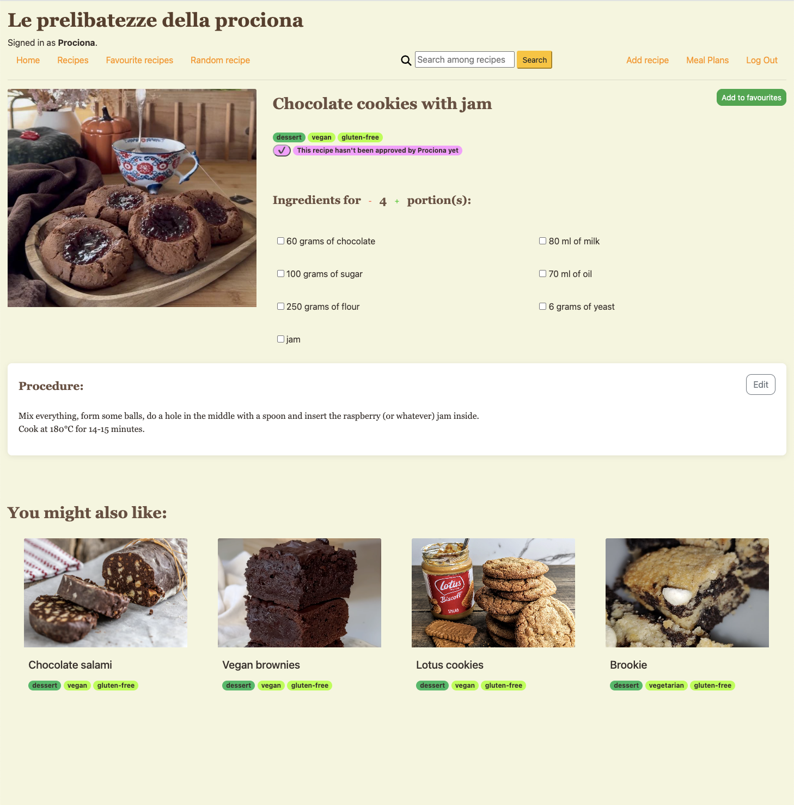
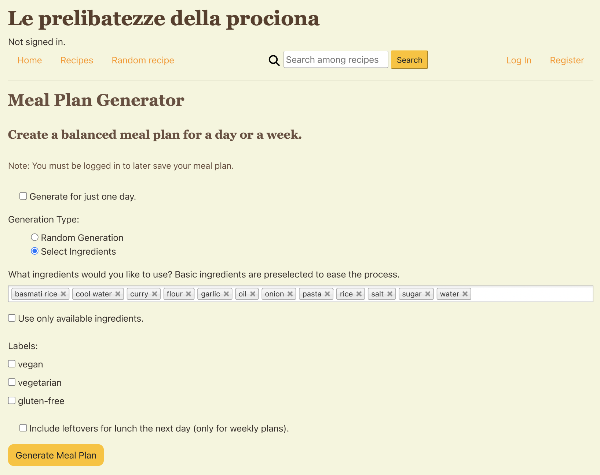

# Final project: recipe book & meal plan
This web application is an online recipe book and meal planner, the workings of which are explained on the homepage. The former is designed to help users discover and save recipes, while the latter generates a balanced meal plan based on user's inputs.<br>
Users can filter recipes by dish type (protein, carbohydrate, vegetables, dessert, sauce), dietary label (vegan, vegetarian, gluten-free) and approval status (whether the recipe has been approved by the super user or not). Additionally, users can search for recipes based on title, ingredients, or procedure.<br>
For every recipe, users can adjust the portion size, and the ingredient quantities will automatically scale accordingly, allowing for meal planning and cooking flexibility. Moreover, they can check off the ingredients to track what they have already used. After each recipe, other similar recipes are recommended.

<p align="center">
  <br>
 Homepage, explaining the recipe book and meal plan generation.
</p>

<p align="center">
  <br>
 Recipes page, where users can filter by dish, label and approval status, or search by words.<br>
 When a user is logged in, they can access the personal pages "Favourite recipes" and "Meal Plans"; the super user can also access the page "Add recipe".
</p>

<p align="center">
  
  <br>
 Two different recipes shown logged in as a user (on the left) and as a super user (on the right). The super user can approve a recipe that has not been tried yet and can edit the procedure.
</p>

<p align="center">
  <br>
 Meal plan generation. When "Select Ingredients" is clicked, users can type in the ingredients.
</p>

## Distinctiveness and Complexity
This project is neither a social network nor an e-commerce site: there are no users interacting with each other, and nothing is sold, bought or bid on. Its core is an algorithm that builds a **nutritionally balanced meal plan** (carbohydrates, protein and vegetables for every day) from the user's preferences, followed by a grocery list computed from the chosen recipes. The **recipe book** feeding this planner is also an important part and, while it shares a few front-end patterns with the [e-commerce project](https://cs50.harvard.edu/web/projects/2/commerce/) (e.g., filtering items by category, saving favourites), it adds the features below.

- Infinite scroll: recipes load dynamically as the user scrolls, improving the browsing experience and reducing page load times.
- Similar recipe recommendations: at the end of each recipe page, the application suggests a maximum of 4 similar recipes based on shared dish labels and the first 4 ingredients. This feature enhances user engagement by helping them discover new recipes.
- Portion scaling: users can increase or decrease the portion size of a recipe, and the ingredient quantities are automatically recalculated to maintain the correct proportions.
- Ingredient checklist: users can temporarily check off ingredients as they add them, acting as a reminder for what has already been included.

Above all, the most distinctive and complex implemented feature is the creation of a balanced **meal plan**, either for a day or a week. In order to generate it, the user can:
- Choose random generation or
- Select the ingredients they already have and decide whether to use only them or possibly buy others. To facilitate this procedure, some basic ingredients are already present;
- Specify a label (vegan, vegetarian, gluten-free);
- Specify whether they would like to prepare more dinner to have lunch the day after.

Then, the user is presented with the meal plan:
- If the ingredients were strictly selected and not enough to generate a balanced meal plan, the user is warned about it;
- The position of each recipe can be changed by dragging a handle, or locked by clicking a padlock;
- The user can name the plan;
- An interactive grocery shopping list is presented, enabling the user to check off ingredients they already have; the list can be copied to the clipboard.
- The meal plan is automatically saved in the "Meal Plans" page accessible on the top right of the webpage, where the user can also delete a plan.

The super user has some extra features:
- Add new recipes: through the designated page on the top right of the webpage (not visible to normal users), the super user inserts the quantity of each ingredient and selects the unit of measure (grams, ml, teaspoon, tablespoon, pieces or by heart). As per the image, they can either insert a file from their device, or an URL. Lastly, they assign the base number of portions, dish type, label and whether they have already tried the recipe or not;
- Every recipe can be modified through Django administration, but for the sake of simplicity the procedure and approval of a recipe are also modifiable on each recipe page.

### Back-End Complexity
Although the design may seem similar to previous projects (e.g., search functionality and random page generation), the back-end logic is significantly more complex:
- **[Many-to-Many Relationships](https://docs.djangoproject.com/en/5.0/ref/models/fields/#django.db.models.ManyToManyField)**: the application uses **Django's `ManyToManyField`** to relate recipes to dishes, labels, ingredients, and users (for favorites).
- **[Intermediary Model](https://docs.djangoproject.com/en/5.0/topics/db/models/#intermediary-manytomany)**: An **intermediary model (`RecipeIngredient`)** is used to store additional details (e.g., quantity and unit of measure) for the relationship between recipes and ingredients.
- **Django Admin Customization**: the **[`TabularInline`](https://docs.djangoproject.com/en/6.0/ref/contrib/admin/#django.contrib.admin.TabularInline)** class is used to edit `RecipeIngredient` directly on the `Recipe` admin page, streamlining data management.
- **Image Uploads**: users can upload images for recipes, which required configuring **Django's [`ModelForm`](https://www.geeksforgeeks.org/python/python-uploading-images-in-django/)** in `forms.py`, configuring `settings.py`, and `urls.py` to handle media files.
- **[Custom Template](https://docs.djangoproject.com/en/6.0/howto/custom-template-tags/)**: extended the template engine by defining a custom filter in `templatetags/custom_filters.py` able to [get an item from a dictionary using a dynamic key](https://github.com/2431540349-art/django-py1/blob/main/accounts/templatetags/custom_filters.py). This was required in order to iterate over the key `day` in the dictionary containing the meal plan.
- **Meal plan generation algorithm**: recipes are grouped by the categories they cover (e.g. a single recipe can cover both carbohydrate and vegetables), and each day is built so that all required categories are present. When leftovers are selected, the next day's lunch reuses the previous dinner and the following dinner is balanced against it. Anonymous users can also generate plans, which are tied to their session.
- **AJAX endpoints**: several features update the database without reloading the page, using JavaScript's `fetch` and Django views that return a `JsonResponse`:
  - Infinite scroll: `infinite_scrolling` checks the `X-Requested-With: XMLHttpRequest` header, so the same URL returns the full page on a normal visit and only the next batch of recipes as JSON when called from `recipebook.js`;
  - Editing a procedure: the super user edits the procedure on the recipe page and `edit_recipe` saves it, returning the updated text;
  - Meal plan drag & drop and locking: `drag_meals.js` sends the new day, meal and position of every recipe to `update_positions`, and the lock state to `toggle_lock`; both send the CSRF token and check that the plan belongs to the current user or session.
- **Data Migration**: **[Django Data Migration](https://docs.djangoproject.com/en/6.0/topics/migrations/#data-migrations)** was used to add default values for dishes and labels, ensuring a clean, permanent and version-controlled way to populate the database.

> [!TIP]
> To create the data migration file, the specific terminal command was
> ```bash
> python manage.py makemigrations recipebook --empty --name add_default_dishes_and_labels
> ```

## Technologies Used
- **Front-End**:
  - HTML
  - **CSS**: custom styles for the application, including responsive design, such as the "copied!" message when the grocery list is copied.
  - **JavaScript**: handles dynamic features like infinite scroll, portion scaling, ingredient checklists, recipe editing, adding and removing an ingredient when creating a recipe. Particularly, in the mealplan application, it shows and hides the ingredient selection field when generating a plan and, most importantly, it allows the user to modify a meal plan by dragging each meal; it also allows the user to copy the grocery list.
  - [Bootstrap](https://getbootstrap.com/) for responsive design, including mobile and other devices responsiveness with a wrapping navigation bar, and custom media queries at 1200, 992, 768 and 600px.
  - [Chosen](https://harvesthq.github.io/chosen/) for user-friendly multi-select dropdowns;
  - [Sortable](https://github.com/SortableJS/Sortable) for changing the position of each meal in the generated meal plan.
- **Back-End**:
  - [Django](https://www.djangoproject.com/) as Python web framework;
  - [Django Admin](https://docs.djangoproject.com/en/5.0/ref/contrib/admin/) for back-end management;
  - [SQLite](https://www.sqlite.org/index.html) as default Django database.

## Code organisation
- `final_project/`: Django project settings, including media files configuration (`settings.py`, `urls.py`).
- `recipebook/` - the recipe book app:
  - `models.py`: `User`, `Dish`, `Label`, `Ingredient`, `Recipe`, `RecipeIngredient`.
  - `views.py`: recipe list with filters and infinite scroll, single recipe, random recipe, search, favourites, login/register, add/edit recipe.
  - `forms.py`: `ModelForm` for adding a recipe, including image upload.
  - `admin.py`: admin configuration with `RecipeIngredient` as `TabularInline`.
  - `migrations/0003_add_default_dishes_and_labels.py`: data migration with the default dishes and labels.
  - `templates/recipebook/`: `layout.html` (shared base), `home.html`, `index.html`, `recipes.html`, `search_results.html`, `favourites.html`, `add_recipe.html`, `login.html`, `register.html`.
  - `static/recipebook/`: `recipebook.js` (infinite scroll, Chosen), `recipes.js` (portion scaling, ingredient checklist, editing a recipe), `add_recipe.js` (adding/removing ingredient rows), `styles.css`.
- `mealplan/` - the meal plan app:
  - `models.py`: `MealPlan` and `MealPlanRecipe` (recipe, day, lunch/dinner, position, lock).
  - `views.py`: meal plan generation algorithm and its helpers, result page with grocery list, saving/locking positions, saving, listing and deleting plans.
  - `forms.py`: `MealPlanForm` with the generation options.
  - `templatetags/custom_filters.py`: `get_item` filter to read a dictionary with a dynamic key in templates.
  - `templates/mealplan/`: `mealplan_generation.html`, `result.html`, `user_mealplans.html`.
  - `static/mealplan/`: `select_ingredients.js` (shows/hides ingredient selection), `drag_meals.js` (drag & drop, lock, copy grocery list), `styles.css`.
- `media/images/`: README screenshots and personally uploaded recipe images, whereas other images are public URLs.
- `db.sqlite3`: database already populated with recipes.
- `requirements.txt`: Python packages to install.

### Models
More precisely, the application includes the following models:
- **`User`**: extends Django's `AbstractUser` to support user authentication and favorites.
- **`Dish`**: represents the type of dish (e.g., protein, carbohydrate, vegetables, sauce, dessert).
- **`Label`**: represents dietary labels (e.g., vegan, vegetarian, gluten-free).
- **`Ingredient`**: stores ingredient names (e.g., tofu, onion).
- **`Recipe`**: the core model, which includes:
  - Fields for title, procedure, image, favourite and approval status (`is_new`).
  - **Many-to-Many Relationships** with `Dish`, `Label`, `Ingredient`, and `User` (for favorites).
  - A **`base_portion`** field to define the default portion size.
  - Methods for **listing ingredients** and **getting similar recipes**.
- **`RecipeIngredient`**: an **intermediary model** for the many-to-many relationship between `Recipe` and `Ingredient`, storing **quantity** and **unit of measure**.
- **`MealPlan`** and **`MealPlanRecipe`**: allow users to save recipes to a meal plan.

### Views and Templates
More precisely, the application uses the following functions:
- **`index`**: displays all recipes with a badge for each type of dish and dietary label which redirects to a filtered index page when clicked.
- **`infinite_scrolling`**: function to easily apply the infinite scroll to every page.
- **`display_filters`**: filters recipes based on user-selected dishes, labels or approval status, returning the index page with applied filters.
- **`recipes`**: shows a single recipe with the option to adjust portions and check off ingredients. At the end of the page, similar recipes are recommended.
- **`random_recipe`**: randomly shows a single recipe.
- **`favourites`**: displays the user's saved recipes.
- **`search`**: search for recipes where the query is contained in the title, procedure or ingredients.
- **`add_recipe`** and **`edit_recipe`**: only the super user can add new recipes and edit them.
- **`edit_recipe`** and **`toggle_is_new`**: without opening Django administration, the super user can edit a recipe and approve it directly on the recipe page.
- **`generate_mealplan`**, **`mealplan_result`** and **`save_mealplan`**: allow users to generate, modify and save meal plans. The former function has some helper functions.
- **`user_mealplans`** and **`delete_mealplan`**: users can access to their meal plans and delete them.

## How to run
Clone the repository and inside the folder `Final project/final_project`:
```bash
pip install -r requirements.txt
python manage.py migrate
python manage.py runserver
```
The repository includes `db.sqlite3`, already populated with recipes, so the app can be used straight away.<br>
To try the super user features (adding, editing and approving recipes), create an account with `python manage.py createsuperuser`.